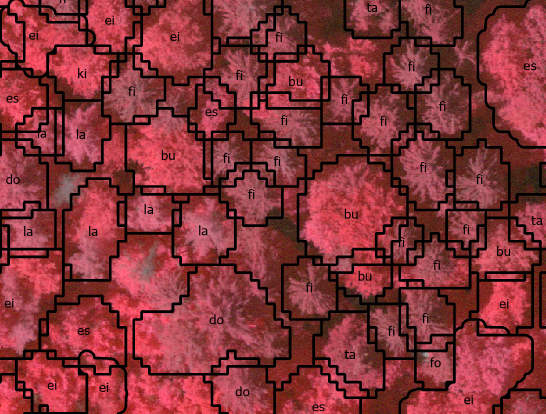

# Tree species segmentation and classification algorithm for SwissimageRS (swisstopo)
Algorithm for tree crown segmentation and tree species classification based on orthophotos. Originally devoloped for the canton of Aargau. Updated and improved for the canton of Fribourg. 

Developed by [Waldfride Analytics](https://waldfride-analytics.ch/).

The orthophoto example (ortho_example.tif) was kindly provided by Federal Office of Topography swisstopo (©swisstopo). The other data examples were kindly provided by the canton of Fribourg.



## Algorithms
Two different neural networks are used: One for the segmentation of the tree crowns and one for the classification of the segmented crowns by tree species.

### Tree crown segmentation
- Model: resnet50_v1b pretrained on the coco dataset. 
- In 320 plots crowns were manually segmented to train the model

### Tree species classification
- Model: MobileNetV2
- Data about 5300 trees was collected in the field to train the model.
- The following classes are distinguished:
    - Maple (Acer spp.)
    - Beech (Fagus sylvatica)
    - Oak (Querqus robur + petraea)
    - Ash (Fraxinus excelsior)
    - Spruce (Picea abies)
    - Scots Pine (Pinus sylvestris)
    - Larch (Larix decidua)
    - Fir (Abies alba)
    - Other hardwood
    - Other coniferous wood (e.g. Douglas)
    - Dead trees
    - Faulty crown segmentations

## Usage

### Clone repository and download data
```
git clone https://github.com/RaffiBienz/arborizer.git
```
Download example data and put it in the data folder: https://drive.google.com/file/d/1hIGiLyLD02LVT8qnlZwNdryt5aRrL02i/view?usp=sharing

Download parameters for the neural networks and put the two folders into the src folder: https://drive.google.com/file/d/183a-_vfWNVwEIEZBtWhVCnvNvpxNZ1lb/view?usp=sharing

### Setup Python
- Install Python 3.10.12
- Open config_template.R and save as config.R.
- Add the path to the python or an anaconda environment in config.R. If python is defined as an environment variable just type "python" in config.R.
- Install packages (see requirements.txt)
- If a suitable GPU is available and the CUDA-environemnt is installed instance segmentation should automatically use the GPU. Otherwise the CPU is used which makes the process much slower. 

**Example setup with Anaconda**

Open Anaconda Powershell Prompt and type (to use with GPU see [below](#a-word-on-gpu-usage)):
```
conda create -y -n arborizer python==3.10.12
conda activate arborizer
pip install gluoncv==0.4.0
pip install numpy==1.23.5
pip install mxnet -f https://dist.mxnet.io/python/cpu
pip install tensorflow==2.17.0
pip install keras==3.5.0
```
Add the path to the python or an anaconda environment in config.R. Typically (Windows): C:/Users/USERNAME/.conda/envs/arborizer/python.exe

### Setup R
- Install R and if desired RStudio.
- Required packages: terra, sf and imager (see install_packages.R)
- These packages are automatically installed when you run main.R.


### Required input data
- Swissiamge RS (10x10 cm / RGBI or IRGB / Federal Office of Topography swisstopo) with trees in leaf.
- Vegetation height model (1x1m / raster) 
- Forest delineation (shapefile)

### Execute script
- If desired, adjust further settings in config.R (at least python_path, see Setup Python).
- Open main.R and set the working directory to the arborizer folder.
- Run main.R (in a shell or via RStudio).
- Check the result folder for the output.

## Performance
Segmentation achieved a mean average precision of 30.9 on the validation dataset. Coniferous trees are not detected as well as deciduous trees. This may be due to the relatively small crowns of coniferous trees. Regarding deciduous trees, the algorithm has the tendency to conjoin the crowns of multiple trees.

Classification achieved an accuracy of 84 % on the test dataset. However, the algorithm works better for coniferous trees than for deciduous trees.

## A word on GPU usage
This is quite a tricky part. The CPU is sufficient for test purposes. For larger areas, however, it is essential to use a GPU or you will be waiting for results for ages (months). In particular for the step of tree crown segementation you will need a GPU up and running. Tree species classification can be carried out on the CPU in a reasonable amount of time.

To set up the GPU to run with the gluoncv framework you need the right combination of graphics card, driver, CUDA version, python version and package versions. I used the following setup:
- GPU: NVIDIA GeForce RTX 3090
- Driver version: 555.99
- CUDA version: 11.2
- Python version 3.6.7
- Package versions: mxnet-cu101==1.5.0 / gluoncv==0.4.0

An instruction on how to set up the CUDA environment can be found here: https://tech.stdl.ch/PROJ-HETRES/#73-reproducibility-of-the-exploratory-project-with-data-produced-by-swisstopo

## Change Log

### Update December 2024 ###
- Basic revision of the scripts.
- Removed dependency on raster and sp packages. Now works with terra and sf.
- Updated tree species classification model to MobileNetV2.
- Trained tree species classification model on data of the canton of Fribourg.

### Update January 2023
The model was improved as follows:
- New tree crown segmentation model trained with more data.
- New tree crown classification model trained with more data.
- Improved overlap cleanup.
- Faster export of tree images.
- Due to poor classification accuracy Quercus rubra was integrated into the class "Other deciduous trees".


